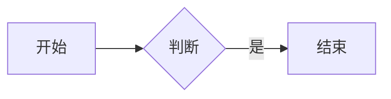

# 20 · 数学公式（KaTeX）与 Mermaid 图表

> 规格对象：`client.js` 的 markdown 渲染链（`parseBlocksCached` / `renderInline` / `renderMarkdown` / `CodeBlock` 及其 CSS）。
> 参照实现：原版 demo `deepseek-ai/chat-demo@5d5dd75`。
> 约定：demo 用 `src/...:行号`；`client.js` 只标函数 / 组件 / CSS 类名，行号写 `≈`（工作区正被并行修改，行号会漂移，以符号名为准）。
> 本文只写规格，不实施。

---

## 0. 结论摘要

1. 版本必须锁死 demo 的两行：`katex@0.16.22`（`package.json:24`）与 `mermaid@11.10.1`（`package.json:29`）；数学解析用的是 fork `micromark-extension-llm-math@3.1.0`（`package.json:31`），比上游多支持 `\(...\)` / `\[...\]` 两种 TeX 定界符。
2. 分隔符（行内）：`$...$`、`\(...\)`；块级：`$$` 围栏、`\[` … `\]`；`\$` 转义成普通美元；代码块 / 行内代码里不解析；空的行内公式不成立；块级围栏数“闭 ≥ 开”。
3. KaTeX 调用参数是 `{ throwOnError: true, strict: false, displayMode: !isInline }`（`MathFormula.tsx:38`）；渲染失败时**保留上一次成功结果**，没有就回退原文（`MathFormula.tsx:43-45`），数学没有“渲染失败”文案。
4. mermaid 配置是 `{ theme: dark?'dark':'default', securityLevel:'strict', startOnLoad:false, suppressErrorRendering:true }`（`mermaid.ts:36-41`）；渲染必须**串行 + 唯一 id + img/image 转义**，流式阶段只画“最后一个完整行”的前缀并保留上一张有效图（`MermaidDiagram.tsx:39-70`），完成后才显示错误。
5. 图表与代码是**两个并排按钮**（默认显示图表），`aria-pressed` 表示当前态（`CodeBlock.tsx:31-49`、`83`）；四条状态文案逐字为「图表 / 代码 / 图表为空 / 图表生成中... / 渲染失败」，切换组 aria-label 为「Mermaid 图表与代码切换」（`zh.ts:41-46`）。
6. 无构建插件里**推荐 CDN 懒加载**（锁定版本、用到才加载、失败可重试）。「把库文件放进插件包再用 fetch 读」这条路**当前不成立**：DSH 的包资产路由只服务图片 MIME（`dsh-client-modules/src/assets.ts:17-23`），`.js/.css/.woff2` 一律 404；要内置必须由 Host 半新增静态路由。
7. 体积参考（jsdelivr 实测）：`mermaid.min.js` 2,711,887 B（本地 gzip 783,169 B）；`katex.min.js` 276,701 B + `katex.min.css` 23,352 B + `mhchem.min.js` 33,712 B；KaTeX 20 个 woff2 合计 259,792 B，按需加载常见 4–6 个（约 100–160 KB）。
8. 最容易踩的三个坑：① KaTeX 的 CSS 必须和字体一起从 CDN 来（自己抄 CSS 会让字体 404）；② mermaid 并发渲染会互相覆盖全局配置与 id；③ 流式半截代码直接渲染会闪错误/闪空图，必须做前缀回退与 100 ms 合并。

---

## 1. demo 的实现事实

### 1.1 版本与依赖

| 依赖 | 版本 | 出处 | 说明 |
| --- | --- | --- | --- |
| `katex` | `0.16.22`（精确锁版本） | `package.json:24` | 运行时渲染 |
| `@types/katex` | `^0.16.5` | `package.json:16` | 仅类型 |
| `mermaid` | `11.10.1`（精确锁版本） | `package.json:29` | 图表渲染 |
| `micromark-extension-llm-math` | `3.1.0` | `package.json:31` | 数学语法扩展（fork） |
| `mdast-util-math` | `3.0.0` | `package.json:28` | AST 侧配套 |
| `micromark-extension-gfm` / `mdast-util-gfm` | `3.0.0` / `3.1.0` | `package.json:30`、`package.json:27` 附近 | 与数学无直接关系，但同在解析入口 |

### 1.2 数学：解析入口与分隔符规则

解析入口（`src/services/markdown/parse.ts:38-45`）：

```ts
const ast = fromMarkdown(input, {
  extensions: [
    { ...gfm(), disable: { null: ['codeIndented'] } },
    math({ singleDollarTextMath: true }),            // ← 数学扩展，开单 $ 行内
  ],
  mdastExtensions: [gfmFromMarkdown(), mathFromMarkdown()],
})
```

`math()` 来自 `micromark-extension-llm-math`（`parse.ts:7`、`package.json:31`），它在上游 `micromark-extension-math` 的 `$` 语法之外再加 `\`（`0x5C`）开头的 TeX 定界符（扩展源码 `lib/syntax.js`：`flow: { $: mathFlow, \\: mathTexFlow }, text: { $: mathText, \\: mathTexText }`）。据此，**规格必须实现的全部写法**：

| 写法 | 位置 | 规则 | 示例 |
| --- | --- | --- | --- |
| `$…$` | 行内 | 开闭 `$` 数量必须相等；不能前后再贴 `$`（序列是贪婪的）；不能为空；可跨行，换行按空格处理 | `质能方程 $E=mc^2$` |
| `$$…$$` | 行内（双 `$`） | 同长度成对，可把单个 `$` 包在中间 | `$$a$b$$` |
| `$$` 围栏 | 块级 | 独占一行开始；闭围栏 `$` 数 ≥ 开围栏；可带 meta（忽略）；**围栏可以不闭合**（吃到文末） | 见 1.2 示例 |
| `\(…\)` | 行内 | LLM fork 新增；`\(` 前不能是反斜杠（`\\(` 不是公式起点） | `\(L_C\)` |
| `\[` … `\]` | 块级 | LLM fork 新增；`\[` 独占一行开始，`\]` 独占一行结束 | 见 1.2 示例 |
| `\$` | 任意 | 转义成字面 `$`，不开启公式 | `\$5 和 \$6` |
| `\\$` | 任意 | `\\` 是“反斜杠”本身，后面的 `$` **仍是公式起点** | `\\$x$` → 字面 `\` + 公式 `x` |

块级示例（demo 解析器会把它变成 `math` 节点，`MarkdownAstRenderer.tsx:168-169` 交给 `MathBlock`）：

```markdown
$$
L = \frac{1}{2} \rho v^2 S C_L
$$

\[
L_C = \frac{1}{2}\rho v^2 S C_L
\]
```

负例（不渲染，保持原文）：

* 行内 `$$x$` / `$x$$`（序列长度不等）。
* 行内 `$ $`（空公式；上游语法明确行内 math 不能为空）。
* 行内 `$$ $$`（只有一个 `$` 算内容，同样为空）。
* 代码块与行内代码里的一切：`` `$x$` ``、` ```math … ``` ` 都按代码显示（解析器里代码优先级高于数学；`parse.ts:74-80` 也只对少数字符替换做特殊处理，不动 math）。

补充规则（上游 readme，`micromark-extension-llm-math` 继承上游语法）：

* 行内公式的首尾各一个空格若同时存在、且公式里有非空格字符，会被去掉（`$ x $` → `x`）。
* 块级公式内部允许按开围栏的缩进对齐；闭围栏最多再缩进 3 个空格。
* 块级公式后必须是换行或文末。
* 行内公式可以折行（换行渲染成空格），所以“一段里出现未闭合的 `$`”不会吞掉后文（只有块级 `$$`/`\[` 会吞到文末或闭围栏）。

### 1.3 KaTeX 渲染参数与外层标签

| 事实 | 出处 |
| --- | --- |
| `renderToString(input, { throwOnError: true, strict: false, displayMode: !isInline })` | `MathFormula.tsx:37-39` |
| KaTeX 自带的外层标签：行内 `<span class="katex">…</span>`；块级 `<span class="katex-display"><span class="katex">…</span></span>` | `MathFormula.tsx:5-8` |
| demo 因为组件自己渲染了外层 `.katex` / `.katex-display`，所以对 `renderToString` 结果**前后切片**，只取内层 | `MathFormula.tsx:36-39`（`slice(prefix.length, -suffix.length)`） |
| 行内成功态：`<span class="katex" dangerouslySetInnerHTML>` | `MathFormula.tsx:66` |
| 块级成功态：`<span class="katex-display ds-markdown-math"><span class="katex" …>` | `MathFormula.tsx:55-57` |
| 块级 CSS：`display/ text-align:center / overflow-x:auto / max-width:100% / padding:4px`，上下 16px，首尾子元素去边距 | `markdown.css:223-242` |
| mhchem（化学公式）扩展也加载：`import('katex/contrib/mhchem')` | `src/services/markdown/katex.ts:11-15` |

> 插件实现不必照抄切片逻辑：直接把完整 `renderToString` 结果塞进容器即可（KaTeX 输出本身已带 `.katex` 类），见 3.3。

### 1.4 KaTeX 懒加载

`src/services/markdown/katex.ts:3-16`：

```ts
let katex: Katex | null = null
let katexPromise: Promise<Katex> | null = null

export const ensureKatex = (): Katex | Promise<Katex> => {
  if (katex !== null) return katex
  katexPromise ??= Promise.all([
    import('katex'),
    import('katex/contrib/mhchem'),
    import('katex/dist/katex.min.css'),
  ]).then(([module]) => (katex = module.default))
  return katexPromise
}
```

要点：

* 单例；已加载时**同步**返回库对象，组件可同步渲染（`MathFormula.tsx:20-29` 用它初始化 state）。
* 加载的是 `katex + mhchem + katex.min.css` 三件套；CSS 必须一起加载，否则字形全是方块 / 字体 404。
* 该实现失败后 `katexPromise` 会保持 rejected，**没有重试**——这是 demo 的小缺陷，插件规格要求补上（见 3.2）。

### 1.5 数学失败回退

| 情况 | demo 行为 | 出处 |
| --- | --- | --- |
| 库还没加载完 | 先把 `input` 原文当结果（`renderMode: 'fallback'`），加载完成触发一次重渲染 | `MathFormula.tsx:31-34`、`25-29` |
| `throwOnError:true` 抛错 | 返回 `previousResultRef.current`（该组件上一次成功结果），没有就原文 | `MathFormula.tsx:43-45` |
| 行内 fallback 渲染 | 直接返回字符串原文（不再是 code 样式） | `MathFormula.tsx:63-65` |
| 块级 fallback 渲染 | `<p class="ds-markdown-paragraph">{原文}</p>` | `MathFormula.tsx:51-53` |

含义：流式输出 `$\frac{1}{` 这种半截公式时，界面保持上一次能渲染的样子（或原文），**不闪烁、不报错、没有失败文案**。

### 1.6 Mermaid：识别、配置、转义、串行

| 事实 | 出处 |
| --- | --- |
| 识别方式：代码块 info string 小写后等于 `mermaid` | `CodeBlock.tsx:82`（`infostring.toLowerCase() === 'mermaid'`） |
| 解析器把 info string 作为 `node.lang || 'text'` 传给 CodeBlock | `MarkdownAstRenderer.tsx:194-202` |
| 初始化配置：`{ theme: dark ? 'dark' : 'default', securityLevel: 'strict', startOnLoad: false, suppressErrorRendering: true }` | `src/services/markdown/mermaid.ts:36-41` |
| 主题来源：组件读应用主题 `useTheme() === 'dark'` | `MermaidDiagram.tsx:15` |
| 转义：把 `img` / `image` 标签的 `<` 换成 `&lt;`（整图范围一次替完） | `mermaid.ts:18` |
| 串行：模块级 `renderQueue = renderQueue.then(...)`，失败不阻塞后续图表 | `mermaid.ts:26-27`、`48-51` |
| 唯一 id：`standalone-mermaid-${nextId++}` | `mermaid.ts:5`、`43` |
| 每次渲染都重新 `initialize`（主题可能变） | `mermaid.ts:36-41` |
| 空代码 / 已取消直接返回 `null` | `mermaid.ts:27-30`、`32-34`、`44` |
| 载入失败会清空缓存的 promise，下一次可重试 | `mermaid.ts:7-15` |

### 1.7 Mermaid 的流式、回退、取消

`MermaidDiagram.tsx` 是一个“本地状态机”，props 只有 `code` 和 `loading`（`7-13`）：

1. `latestCodeRef.current = code`：流式时从 ref 拿最新文本（`17-18`）。
2. 只在 `loading` 为 false 时把 code 当“最终内容”（`20`，`finalCode = loading ? null : code`）。
3. 绘制函数 `draw()`：`input === displayedCode || cancelled` 直接返回；`renderMermaid(...)` 成功才 `setResult({ svg, failedCode:null })`（`28-37`）。
4. 流式中失败：取“去掉末行后的前缀”，如果已显示内容不是该前缀的覆盖（`!displayedCode?.startsWith(prefix)`）才尝试画前缀；前缀也失败就保住旧图（`47-59`）。
5. 结束后失败：`setResult({ svg:'', failedCode: input })`（`60-62`）。
6. 流式中每 100 ms 合并一次连续输入（`66-69`）。
7. 清理：`cancelled = true; clearTimeout(timer)`（`73-76`）。

状态文案渲染规则（`MermaidDiagram.tsx:79-91`）：

```tsx
if (!code.trim() || !result.svg) {
  return <div className="md-mermaid-status" role="status">
    {!loading && !code.trim()
      ? t('mermaidEmpty')                    // 图表为空
      : !loading && result.failedCode === code
        ? t('mermaidRenderFail')             // 渲染失败
        : t('mermaidLoading')}               // 图表生成中...
  </div>
}
return <div className="md-mermaid-diagram" dangerouslySetInnerHTML={{ __html: result.svg }} />
```

即：**有 svg 就只显示图**；没有 svg 时按“空 → 失败 → 生成中”优先级只显示一行状态；正在流式时永远显示“图表生成中...”（不提前报错）。

### 1.8 图表 ↔ 代码切换

`CodeBlock.tsx`：

| 行为 | 出处 |
| --- | --- |
| `isMermaid` 判定 | `82` |
| 默认 `showDiagram = true`（默认显示图表） | `83` |
| 两个按钮：前「图表」`t('mermaidDiagram')`，后「代码」`t('mermaidCode')` | `33-40`、`41-48` |
| 当前态用 `aria-pressed`：`aria-pressed={showDiagram}` / `aria-pressed={!showDiagram}` | `36`、`44` |
| 点已激活的按钮无动作（`!showDiagram && onToggle` / `showDiagram && onToggle`） | `37`、`45` |
| 切换组容器：`className="md-code-block-switch"`、`aria-label={t('mermaidSwitchLabel')}` | `32` |
| 有切换按钮时左侧语言名不显示（`infostring` 只在不支持切换时显示） | `31-52` |
| 右侧始终有复制按钮（`复制`/`已复制`，1.5 s 复位；失败 toast `copyFailed`） | `53-67`、`62`、`58`；文案 `zh.ts:26-28` |
| 图表模式渲染 `<MermaidDiagram code loading>`；代码模式渲染 `<pre dangerouslySetInnerHTML=Prism 高亮结果>` | `116-120` |
| 代码模式下 **MermaidDiagram 被卸载**（切回图表会重新渲染一次） | `116-120`（条件渲染） |

样式（`src/components/markdown/markdown.css`）：

| 选择器 | 关键值 | 行 |
| --- | --- | --- |
| `.md-code-block` | `margin:16px 0`；圆角 12px；背景 `--dsw-alias-markdown-code-block`；banner 背景 `…-code-block-banner` | `309-343` |
| `.md-code-block-switch` | `display:flex; gap:4px`；`[aria-pressed='true']` 用 banner 背景 + label-primary 文字 | `349-357` |
| `.md-mermaid-diagram` | `padding:16px; overflow:auto; text-align:center`；`> svg { display:block; max-width:100%; height:auto; margin:0 auto }` | `359-370` |
| `.md-mermaid-status` | `display:flex; align-items:center; justify-content:center; min-height:160px; padding:16px; color:--dsw-alias-label-secondary; font-size:14px` | `372-380` |
| 按钮（CodeBlock.module.css） | `height:28px; padding:0 10px; border-radius:8px; font-size:13px`；hover/active `--dsw-alias-interactive-bg-hover`；`svg 14px` | `17-46` |
| banner 容器 | `padding:6px; justify-content:space-between; align-items:center` | `1-7` |

### 1.9 文案（逐字）

`src/i18n/zh.ts:41-46`：

| key | 中文（逐字） |
| --- | --- |
| `mermaidDiagram` | `图表` |
| `mermaidCode` | `代码` |
| `mermaidEmpty` | `图表为空` |
| `mermaidLoading` | `图表生成中...`（三个半角点，**不是**省略号 `…`） |
| `mermaidRenderFail` | `渲染失败` |
| `mermaidSwitchLabel` | `Mermaid 图表与代码切换` |

相关但非本规格：复制按钮 `copy`/`copied`/`copyFailed`（`zh.ts:26-28`）。

数学没有专属文案：加载中、失败都静默回退（1.5）。

---

## 2. 无构建插件里的加载方案（CDN vs 内置）

### 2.1 环境事实（决定推荐）

| 事实 | 证据 |
| --- | --- |
| 插件 UI 是单文件 `client.js`，通过 `window.__ModuleLoader__.load({id, factory})` 注入，无打包步骤 | `client.js:13-18` |
| DSH 把客户端 bundle 组合成脚本由宿主源提供；插件包内静态资产走 `/plugins/<pkg>/assets/<path>` | `dsh-client-modules/src/index.ts:233-241`、`705` |
| **该资产路由只认 5 种图片 MIME**：`.svg` `image/svg+xml`、`.png`、`.webp`、`.jpg`、`.jpeg`；其他扩展（`.js`、`.css`、`.woff2`）返回 404 | `dsh-client-modules/src/assets.ts:17-23`、`42-46`、`index.ts:1246-1248` |
| 包资产还要求 `package.json` 有 `./assets/*` 导出且目标固定为 `./lib/assets/*`（DSH 构建期约定） | `assets.ts:26-32` |
| 所以「把 katex/mermaid 文件放进插件包、客户端 `fetch()` 读」**没有可用 URL**；唯一豁免是 `client.<name>.js` 形式的 chunk 路由（依赖 `?rev=`、属未公开契约，不建议） | `dsh-client-modules/src/index.ts:201`、`1161-1211` |
| DSH 文档明确：浏览器侧 React 来自模块表，“no duplicate React installation, CDN script, or UMD search is needed” | `dsh-agent-preset/skills/dsh-doc/references/ui-plugin.md:9` |
| 页面没有注入 CSP：检索 `dsh-host-webserver`（119 文件）与 `dsh-desktop-host` 等（95 文件）均无 `Content-Security-Policy` / `onHeadersReceived`；唯一特例是直接打开 SVG 资产时加 `script-src 'none'` | `dsh-client-modules/src/index.ts:1255`（检索结果见本文附录） |
| 页面 origin 是 `http://127.0.0.1:55160`（HTTP 回环，Chromium/Electron）。从 HTTP 页面加载 HTTPS 外部脚本不构成混合内容拦截（混合内容规则只约束 HTTPS 页面加载 HTTP 资源） | 运行时上下文；Chromium 规范 |
| 本机可达 jsdelivr：以下 URL 实测 HTTP 200 —— `katex@0.16.22/dist/katex.min.js`、`.../katex.min.css`、`.../contrib/mhchem.min.js`、`mermaid@11.10.1/dist/mermaid.min.js` | 本次实测（2026-11-16）；`mermaid.min.js` 末尾是 `globalThis["mermaid"] = …default;`，KaTeX 是 `e.katex=t()`，全局名分别是 `mermaid` / `katex` |
| **但页面是否真的能出网没有 100% 保证**：企业代理/内网可能只放行 `api.deepseek.com`；DSH 自身的 `web_fetch` 走 Host，不代表渲染进程能访问 CDN | 推论；首次接入需按 4.4 实测一次 |

### 2.2 方案对比

| 维度 | A. CDN 懒加载（推荐） | B. 放进插件包 + fetch 读（按现状**不可行**） | C. 放进插件包 + Host 静态路由 | D. 内联进 client.js |
| --- | --- | --- | --- | --- |
| 包体积 | +0 | +3.05 MB（mermaid 2.71 MB + katex 0.28 MB + css/mhchem）+ 可选字体 0.26 MB | 同 B | client.js 从 ~200 KB 涨到 ~3.2 MB |
| 首次出现公式/图表 | 需联网下载：数学 ≈330 KB（+字体 100–160 KB），图表 ≈2.6 MB（gzip ≈765 KB） | 本地读，毫秒级 | 本地读，毫秒级 | 无下载，但**每次打开 DSH 页面**都要解析 3 MB |
| 离线 / 内网 | ❌ 失败（回退原文 / 代码） | ✅ | ✅ | ✅ |
| 实现成本 | 低：`loadScript`/`loadLink` + 版本常量 | ❌ 无 URL 可读，不可实现 | 中：改 `index.js` 注入 `webServer`，自写路由 + MIME + 缓存头；headless 无 webServer 需降级 | 中高：要 `new Function`/Blob 执行 UMD；巨型单文件难维护 |
| 版本控制 | 锁 URL 里的版本号（与 demo 一致） | 锁包内文件 | 锁包内文件 | 锁源码 |
| 失败表现 | 数学回退原文；mermaid `渲染失败`，可切代码 | — | 无外部失败 | 无外部失败 |
| 页面启动成本 | 0（用到才加载） | 0 | 0 | **每次都付**（`dsh.client.immediately: true`，见 `package.json` 的 `dsh.client`） |
| 依赖 DSH 内部契约 | 无 | 无（但也没入口） | `webServer.register` 服务（公开 Service） | 无 |
| 结论 | **v1 唯一实现** | 不可行，写进规格防误做 | 仅当“离线”是硬需求才做 | 不推荐 |

补充：方案 B 的变体“把文件改名成 `client.katex.js` 走 chunk 路由”技术上能跑（`dsh-client-modules/src/index.ts:201` 的 `CLIENT_CHUNK` 正则 + `?rev=` 取自 `window.__DSH_BOOT__`），但这是**未公开契约**，DSH 改一行正则就废，不写进产品实现。

### 2.3 推荐：方案 A（CDN 懒加载）

**明确推荐：CDN 懒加载，锁定 demo 同版本，用到才加载，失败优雅回退。** 理由：

1. 插件不打包，CDN 是唯一“零体积、零 Host 改动”的可行方案。
2. 核心聊天本来就必须联网（DeepSeek API）；数学/图表不是每页都出现，懒加载不拖慢面板。
3. 包体积从 ~200 KB 涨到 3 MB（+1450%）对“每次打开 DSH 都会加载插件 bundle”的场景不可接受（方案 D 的致命点）。
4. 失败可回退成原文 / 代码，不会白屏；mermaid 失败还能切代码视图看源码，符合 demo 的降级哲学。

落地参数（实现必须逐条满足）：

| 项 | 规定 |
| --- | --- |
| KaTeX JS | `https://cdn.jsdelivr.net/npm/katex@0.16.22/dist/katex.min.js` |
| KaTeX CSS | `https://cdn.jsdelivr.net/npm/katex@0.16.22/dist/katex.min.css`（插一个 `<link id="dsc-katex-css">` 到 `document.head`，ID 去重） |
| mhchem | `https://cdn.jsdelivr.net/npm/katex@0.16.22/dist/contrib/mhchem.min.js`，**必须在 katex.min.js 之后**加载（该 UMD 依赖全局 `katex`：`e(t.katex)` 并回填到全局） |
| mermaid | `https://cdn.jsdelivr.net/npm/mermaid@11.10.1/dist/mermaid.min.js`（单文件 UMD，内部已带一份 KaTeX 用于图表内数学标签，无需另配） |
| 触发时机 | 只在真正出现对应内容时加载：数学 = 块里有 `math` 块或行内有公式 token；mermaid = 有 `lang === 'mermaid'` 的代码块。不要面板一打开就预加载 |
| 单例 | 每个库一个模块级 promise：`vendor.katexLoading` / `vendor.mermaidLoading`；成功存对象，**失败清空 promise**（下次消息可重试，对齐 `mermaid.ts:7-15` 的思路） |
| 超时 | `loadScript`/`loadLink` 加 15 s 超时（`setTimeout` 后 reject/false），避免离线时永远“图表生成中...” |
| 顺序 | KaTeX：JS → mhchem（CSS 可并行）；mermaid 独立，不依赖 KaTeX |
| 主题 | 不在加载时定死；每次渲染前在串行队列里 `initialize({theme: dark?'dark':'default', ...})`（对齐 `mermaid.ts:36-41`），暗色切换后重渲染 |
| 安全 | KaTeX 不开 `trust`（默认 false）；mermaid 必须 `securityLevel:'strict'`、`suppressErrorRendering:true`；`img/image` 转义对齐 `mermaid.ts:18`；不要用 `securityLevel:'loose'` |
| 缓存 | 模块级 `mathCache`（键 `displayMode + '\0' + tex`，上限 200，满了整体清空，与客户端现有 `blockCache` 同款策略）；mermaid 默认不跨消息缓存，可选 LRU 20 |
| 版本纪律 | 版本号写成常量 `KATEX_VERSION = '0.16.22'`、`MERMAID_VERSION = '11.10.1'`，URL 由常量拼出；**不准**用 `@latest`/`@11` 这类浮动版本 |

失败矩阵：

| 失败点 | 数学 | Mermaid |
| --- | --- | --- |
| 脚本 404 / 网络失败 / 超时 | 回退原文（行内纯文本，块级普通段落） | 图表视图显示 `渲染失败`，`代码` 按钮仍可切到源码；控制台 warn 一次 |
| 版本已加载但渲染抛错 | 保留该公式上一次成功结果，否则回退原文 | 保留上一张有效图；`loading=false` 且最终失败才显示 `渲染失败` |
| 离线（`navigator.onLine === false` 可提前判断，仅作优化） | 同上，不弹窗、不提示“无法加载” | 同上 |

### 2.4 若“离线可用”是硬需求（第二阶段，可选）

必须走 **方案 C（Host 静态路由）**，而不是把库塞进 `client.js`：

1. 插件 Host 半 `index.js` 现在是空 `apply()`，改为 `ctx.inject(['webServer'], (ctx) => ctx.effect(() => ctx.webServer.register({ kind:'prefix', path:'/plugins/@local/dsh-deepseek-chat/vendor', resource }), 'deepseek-chat: vendor'))`（`register` 用法见 `dsh-client-modules/src/index.ts:703-708`）。
2. 资源根放 `vendor/`（`katex.min.js`、`katex.min.css`、`fonts/*.woff2`、`mhchem.min.js`、`mermaid.min.js`），`package.json#files` 加上 `vendor`。
3. 路由要自己给 `content-type`（`text/javascript`、`text/css`、`font/woff2`）与 `cache-control: public, max-age=31536000, immutable`；注意 DSH 的资产路由不支持这些 MIME，所以**不能**复用 `/assets/` 前缀。
4. 客户端优先走本地 `/plugins/@local/dsh-deepseek-chat/vendor/...`，失败再回退 CDN；默认关闭（`settings.offlineMath` 之类）。
5. 代价：包 +3.05 MB、要处理 `webServer` 不存在（headless）时的 optional inject、桌面端与 web 端两条路径都要测。**v1 不做。**

---

## 3. 落在 `client.js` 的具体落点

### 3.1 符号落点总表

| 落点 | 位置/符号 | 要做的事 |
| --- | --- | --- |
| 文案字典 | `zh` / `en` 对象（`client.js` 顶部；zh 现有 `mermaidDiagram/Code/Loading/RenderFail/SwitchLabel` ≈，**缺 `mermaidEmpty`**） | 补 `mermaidEmpty:'图表为空'`；逐字核对 5 条；en 对应补 `'Chart is empty'` |
| 版本常量 | 新常量区（`TTS_VOICES`、`RECORDING_LIMIT_SECONDS` 附近） | `KATEX_VERSION='0.16.22'`、`MERMAID_VERSION='11.10.1'`、`KATEX_CDN`/`MERMAID_CDN` 拼 URL |
| 库加载 | 已有 `loadScript`、`vendor`、`notifyVendor`、`useVendor`、`ensureKatex`、`ensureMermaid`、`isDarkPage` | 按 2.3 改：加 `loadLink`、超时、失败清空 promise、`mhchem`、清洗 `window.katex` 校验、mermaid 配置 |
| 数学组件 | `MathSpan({tex, display})` | 参数改 `{ throwOnError:true, strict:false, displayMode:Boolean(display) }`；加 per-instance last-good；失败回退原文而不是 `<code>`；类名 `.dsc-mathInline` / `.dsc-mathBlock` |
| 行内解析 | `INLINE_PATTERN` + `renderInline` | 增加 `\(...\)`、`$...$` 分支（在 `$` 分支之前判断转义）；strong/em/del 内部改为递归 `renderInline`，让 `**$x$**` 能出公式 |
| 块级解析 | `parseBlocks` | 在代码围栏之后、标题之前识别 `$$` 与 `\[` 块；`startsBlock` 增加数学围栏；产出 `{type:'math', text}` |
| markdown 渲染 | `renderMarkdown(source, t, keyBase, sources)` | 增加第 5 参 `streaming`；`math` 块 → `MathBlock`；mermaid 代码块 → `MermaidBlock`（现在已有分支，需传 `streaming`） |
| 代码块 | `CodeBlock(props)` | 增加 `streaming`；mermaid 时渲染 `MermaidBlock`（含两个按钮），不要套用 `.dsc-codeToggle` 折叠 |
| 图表组件 | `MermaidBlock`（已有雏形） | 改成 1.7 的状态机：`result {svg, failedCode}`、`latestCodeRef`、100 ms 合并、前缀回退、串行队列、每次 `initialize` |
| 唯一 id | 模块级 `mermaidSeq` | `'dsc-mermaid-' + (mermaidSeq++)`；不要用 `Math.random()`（并发时仍可能撞、也不可复现） |
| 排队 | 模块级 `mermaidQueue = Promise.resolve()` | 所有 `initialize+render` 都排进队列；单个失败不影响后续 |
| 样式 | `CSS` 模板字符串（`const CSS = \`` 段） | 新增/覆盖 `.dsc-mathInline`、`.dsc-mathBlock`、`.dsc-mathRaw`、`.dsc-mermaid`、`.dsc-mermaidState`、`.dsc-codeSeg`、`.dsc-codeSegBtn`；只允许 `--dsw-*` / `--dsh-*` token |

### 3.2 解析层改法（可照抄）

**行内**（`renderInline`，在 `INLINE_PATTERN` 里加两个分支，放在链接/强调之前即可，代码 token 会自然先吃掉代码内内容）：

```js
// 追加到 INLINE_PATTERN 末尾（注意顺序：代码、图片、链接在前）
|(\$\$[\s\S]+?\$\$)|(?<!\\)\$([^$\n]+?)\$(?!\$)|\\\(([\s\S]+?)\\\)|\\\[([\s\S]+?)\\\]
```

匹配后：

```js
if (token.charAt(0) === '$' || token.indexOf('\\(') === 0 || token.indexOf('\\[') === 0) {
  const display = token.indexOf('$$') === 0 || token.indexOf('\\[') === 0;
  const tex = token
    .replace(/^\$\$?|\\[\(\[]/, '')
    .replace(/\$\$?$|\\[\)\]]$/, '')
    .trim();
  if (tex) nodes.push(h(MathSpan, { key, tex, display }));
  else nodes.push(token);            // 空公式：保持原文
}
```

同时把 `strong` / `em` / `del` 分支从“纯字符串”改成递归：

```js
nodes.push(h('strong', { key }, renderInline(inner, key + '-s', sources)));
```

（否则 `**$E=mc^2$**`、`**`code`**` 这类嵌套在 demo 里能渲染，在插件里会退化成字面量。）

**块级**（`parseBlocks` 的 while 循环，放在代码围栏 `if (fence)` 之后、heading 之前）：

```js
const mathOpen = line.match(/^\s*(\$\$|\\\[)\s*$/);
if (mathOpen) {
  const marker = mathOpen[1] === '$$' ? '$$' : '\\]';
  const close = marker === '$$' ? /^\s*\$\$\s*$/ : /^\s*\\\]\s*$/;
  const body = [];
  i += 1;
  while (i < lines.length && !close.test(lines[i])) { body.push(lines[i]); i += 1; }
  i += 1;                                  // 跳过闭围栏（流式时可能没有，等价于吃到文末）
  blocks.push({ type: 'math', text: body.join('\n') });
  continue;
}
```

并在 `startsBlock(line)` 里追加 `/^\s*(\$\$|\\\[)/`，避免数学块被并进上一段。

`renderMarkdown` 里加分支：

```js
if (block.type === 'math') return h(MathBlock, { key, tex: block.text });
```

**不解析数学的位置**：代码围栏（`parseBlocks` 单独成 `code` 块）、行内代码（`INLINE_PATTERN` 的 code 分支先命中）、HTML 注释等原始 HTML 片段（当前解析器整体不解析 HTML，保持现状即可）。

### 3.3 数学组件

```js
function MathSpan(props) {
  const { tex, display } = props;
  const libs = useVendor();
  const lastGood = useRef('');
  useEffect(() => { ensureKatex(); }, []);
  if (!libs.katex) return display ? h('p', { className: 'dsc-mdPara' }, tex) : tex;
  const cacheKey = (display ? 'b:' : 'i:') + tex;
  if (mathCache.has(cacheKey)) {
    const html = mathCache.get(cacheKey);
    if (html) return h('span', { className: display ? 'dsc-mathBlock' : 'dsc-mathInline', dangerouslySetInnerHTML: { __html: html } });
    return display ? h('p', { className: 'dsc-mdPara' }, tex) : tex;
  }
  try {
    const html = libs.katex.renderToString(tex, { throwOnError: true, strict: false, displayMode: Boolean(display) });
    lastGood.current = html;
    // 上限 200，满了整体清空（对齐 blockCache 的策略）
    if (mathCache.size >= 200) mathCache.clear();
    mathCache.set(cacheKey, html);
    return h('span', { className: display ? 'dsc-mathBlock' : 'dsc-mathInline', dangerouslySetInnerHTML: { __html: html } });
  } catch (error) {
    if (lastGood.current) {
      return h('span', { className: display ? 'dsc-mathBlock' : 'dsc-mathInline', dangerouslySetInnerHTML: { __html: lastGood.current } });
    }
    return display ? h('p', { className: 'dsc-mdPara' }, tex) : tex;   // 回退原文，不显示错误
  }
}
```

注意：

* 不要再切片 KaTeX 外层标签（demo 的切片只是为了给外层加自己的 class，插件直接包容器更稳）。
* `throwOnError:true` 是有意为之：流式半截公式靠它进入“上次成功结果”分支；`strict:false` 与 demo 一致（只放宽警告，不影响安全）。
* 每次渲染都 try 一次会重复渲染流式里同一公式——用 `mathCache` 挡住；流式内容每次 source 变长，只有末尾那条公式未命中，代价可接受。
* 若担心 KaTeX 渲染耗时，可再加 100 ms 节流（与 mermaid 一致），但 demo 没有，非必需。

### 3.4 Mermaid 组件（按 1.7 复刻）

```js
function MermaidBlock(props) {
  const { code, streaming, t } = props;
  const libs = useVendor();
  const [mode, setMode] = useState('diagram');            // 默认图表
  const [result, setResult] = useState({ svg: '', failedCode: null });
  const latestCodeRef = useRef(code); latestCodeRef.current = code;
  const finalCode = streaming ? null : code;              // 对齐 MermaidDiagram.tsx:20

  useEffect(() => {
    if (!libs.mermaid) { ensureMermaid(); return undefined; }
    let cancelled = false, timer, previousCode, displayedCode;
    const draw = async (input) => {
      if (input === displayedCode || cancelled) return;
      const svg = await renderMermaidQueued(input, isDarkPage(), () => cancelled);
      if (svg && !cancelled) { displayedCode = input; setResult({ svg, failedCode: null }); }
    };
    const renderLatest = async () => {
      const input = latestCodeRef.current;
      if (input !== previousCode) {
        previousCode = input;
        try { await draw(input); }
        catch (error) {
          if (cancelled) return;
          if (streaming) {                    // 只画去掉末行后的前缀，失败就保旧图
            const text = input.trimEnd();
            const cut = Math.max(text.lastIndexOf('\n'), text.lastIndexOf('\r'));
            const prefix = text.slice(0, Math.max(0, cut));
            if (prefix && !(displayedCode || '').startsWith(prefix)) { try { await draw(prefix); } catch (e) { /* 保旧图 */ } }
          } else {
            setResult({ svg: '', failedCode: input });
          }
        }
      }
      if (!cancelled && streaming) timer = setTimeout(renderLatest, 100);
    };
    renderLatest();
    return () => { cancelled = true; clearTimeout(timer); };
  }, [libs.mermaid, streaming, finalCode, code]);
  // …渲染：两个按钮 + 状态行 + svg，见 3.5
}
```

`renderMermaidQueued`（模块级，替代 demo 的 `renderQueue`）：

```js
let mermaidQueue = Promise.resolve();
let mermaidSeq = 0;
function renderMermaidQueued(code, dark, isCancelled) {
  const run = mermaidQueue.then(async () => {
    if (isCancelled() || !String(code).trim()) return null;
    const mermaid = await ensureMermaid();                       // 返回实例或 null
    if (!mermaid || isCancelled()) return null;
    mermaid.initialize({
      theme: dark ? 'dark' : 'default',
      securityLevel: 'strict',
      startOnLoad: false,
      suppressErrorRendering: true,
    });
    const safe = String(code).replace(/<((?:img|image)\s+)/gi, '&lt;$1');
    const { svg } = await mermaid.render('dsc-mermaid-' + (mermaidSeq++), safe);
    return isCancelled() ? null : svg;
  });
  mermaidQueue = run.then(() => {}, () => {});
  return run;
}
```

要点提醒：

* `ensureMermaid` 必须是**返回实例的异步函数**（不要只在加载时初始化一次），否则主题切换后图不跟着变；WIP 里“只 initialize 一次”的写法需要按此修正。
* `suppressErrorRendering:true` 必须开：否则 mermaid 会向 `document.body` 追加它自己的错误 SVG，污染 DSH 页面。
* 图表模式才挂载渲染（切到代码就卸载），与 `CodeBlock.tsx:116-120` 一致；若要避免重复渲染可隐藏而不是卸载，属可选优化。
* `dangerouslySetInnerHTML` 只注入库产生的 SVG；`securityLevel:'strict'` 下 mermaid 已禁止点击事件与外链脚本。

### 3.5 图表/代码 UI 与 CSS

```js
h('div', { className: 'dsc-code' + (isMermaid ? ' dsc-codeMermaid' : '') },
  h('div', { className: 'dsc-codeHead' },
    isMermaid
      ? h('div', { className: 'dsc-codeSeg', role: 'group', 'aria-label': t('mermaidSwitchLabel') },
          h('button', { type: 'button', className: 'dsc-codeSegBtn', 'aria-pressed': mode === 'diagram' ? 'true' : 'false', onClick: () => setMode('diagram') }, t('mermaidDiagram')),
          h('button', { type: 'button', className: 'dsc-codeSegBtn', 'aria-pressed': mode === 'code' ? 'true' : 'false', onClick: () => setMode('code') }, t('mermaidCode')))
      : h('span', { className: 'dsc-codeLang' }, lang || 'text'),
    h('button', { type: 'button', className: 'dsc-codeCopy', onClick: copy }, copied ? t('copied') : t('copy'))),
  body)
```

状态行与图（优先级对齐 1.7）：

```js
let body;
if (mode === 'code') {
  body = h('div', { className: 'dsc-codeScroll', 'data-clipped': 'false' },
    h('pre', { className: 'dsc-codeBody' }, h('code', null, code)));      // 插件高亮器没有 mermaid 语法，纯文本；不要折叠
} else if (!libs.mermaid || !result.svg) {
  body = h('div', { className: 'dsc-mermaidState', role: 'status' },
    !streaming && !String(code).trim() ? t('mermaidEmpty')
      : !streaming && result.failedCode === code ? t('mermaidRenderFail')
        : t('mermaidLoading'));
} else {
  body = h('div', { className: 'dsc-mermaid', dangerouslySetInnerHTML: { __html: result.svg } });
}
```

CSS（只加在 `CSS` 模板串里；token 全部来自 DSH）：

```css
.dsc-mathInline { display: inline; }
.dsc-mathInline .katex { font-size: 1.02em; }
.dsc-mathBlock { display: block; margin: 10px 0; padding: 2px 0; overflow-x: auto; overflow-y: hidden; max-width: 100%; text-align: center; }
.dsc-mathBlock .katex-display { margin: 0; }
.dsc-mathRaw { font-family: var(--dsh-font-family-code, ui-monospace, monospace); font-size: 0.94em; }

.dsc-codeSeg { display: flex; gap: 4px; margin-right: auto; }
.dsc-codeSegBtn {
  height: 28px; padding: 0 10px; border: 0; border-radius: 8px;
  background: transparent; color: var(--dsw-alias-label-secondary);
  font-size: 13px; line-height: 20px; cursor: pointer;
}
.dsc-codeSegBtn:hover { background: var(--dsw-alias-bg-layer-2); color: var(--dsw-alias-label-primary); }
.dsc-codeSegBtn[aria-pressed='true'] { background: var(--dsw-alias-bg-layer-2); color: var(--dsw-alias-label-primary); }

.dsc-mermaid { padding: 12px; overflow: auto; text-align: center; }
.dsc-mermaid > svg { display: block; max-width: 100%; height: auto; margin: 0 auto; }
.dsc-mermaidState {
  display: flex; align-items: center; justify-content: center;
  min-height: 160px; padding: 16px;
  color: var(--dsw-alias-label-secondary); font-size: 14px;
}
```

对齐 demo 的关键值：切换组 `gap:4px`、按钮高 28、圆角 8、字号 13（`CodeBlock.module.css:17-46`）；图表区 `padding:16px`、`text-align:center`、SVG `max-width:100%`（`markdown.css:359-370`）；状态行 `min-height:160px`、字号 14、次要色（`markdown.css:372-380`）。插件容器已有 `border/radius/background` 的 `.dsc-code`，直接复用。

### 3.6 缓存与并发注意点（务必写进实现注释）

1. **KaTeX 单例 + 失败可重试**：promise 成功才缓存实例；失败 `katexPromise = null`，下一次公式再试，避免一次网络抖动让整段对话永远没有公式。
2. **KaTeX 结果缓存**：键必须带 `displayMode`（同一个 `x` 行内/块级 HTML 不同）；上限 200，满则 `clear()`（与 `blockCache`/`highlightCache` 的现有策略一致）。
3. **mermaid 全局状态**：`initialize` 改的是全局配置，`render` 期间不能有第二个并发调用；`mermaidQueue` 是硬约束，不是优化。
4. **id**：每次 `render` 用自增 `mermaidSeq`，不要复用、不要随机；失败重试也用新 id。
5. **流式**：`loading`/`streaming` 为 true 时不要对“当前完整文本”直接 `render`（末行可能是 `A -->` 这种半截），先试完整文本，失败再试最后一个换行前缀；已显示图的前缀覆盖检查用 `displayedCode?.startsWith(prefix)`（`MermaidDiagram.tsx:53`）。
6. **取消**：组件卸载、代码变化、手动切到代码视图都要置 `cancelled` 并 `clearTimeout`；迟到的 `render` 结果不得 `setState`。
7. **主题切换**：`isDarkPage()` 在每次渲染取一次（或订阅 `MutationObserver` / `matchMedia` 后重渲染），mermaid 必须重画；KaTeX 不需要（用 `currentColor`）。
8. **不要 cross-message 缓存 mermaid SVG**：svg 里带唯一 id 和 `<style>`，跨消息复用会串样式；若要做，只缓存 code+dark 相同且做 id 重写。

---

## 4. 验收与用例

### 4.1 验收清单

- [ ] 版本常量是 `0.16.22` / `11.10.1`，与 demo 一致；没有浮动版本。
- [ ] 数学：行内 `$x$`、`\(x\)`、块级 `$$…$$`、`\[…\]` 都能渲染；`\$` 显示美元符号；代码块/行内代码里不渲染；`$$x$`、`$x$$` 保持原文。
- [ ] 流式半截公式：先出原文或上一次成功结果，不出现错误、不闪烁。
- [ ] mermaid：合法图出 SVG；非法图完成后显示 `渲染失败`；空代码显示 `图表为空`；流式中显示 `图表生成中...`；流式半截不闪错误、不把旧图清掉。
- [ ] 两个按钮「图表 / 代码」默认选中图表，`aria-pressed` 正确，容器 `aria-label` 是 `Mermaid 图表与代码切换`；切代码能看到源码，切回图表能恢复。
- [ ] 复制按钮在两种模式下都在，文案 `复制`→`已复制` 1.4–1.5 s 复位。
- [ ] 离线（DevTools 断网）时：数学原文、图表 `渲染失败` + 代码可看；不白屏、不弹莫名错误；控制台每条库只 warn 一次。
- [ ] 暗色主题切换后 mermaid 重画为新主题；KaTeX 颜色跟随文字。
- [ ] 两条消息同时有 mermaid：不互相覆盖（串行 + 唯一 id）。
- [ ] 打开 DSH 页面但从未打开聊天面板 / 从未出现公式图表：**零 CDN 请求**。

### 4.2 测试文本

```markdown
行内：质能方程 $E = mc^2$，等价写法 \(E = mc^2\)，价格 \$5 到 \$6。

块级：

$$
L = \frac{1}{2} \rho v^2 S C_L
$$

化学：$\ce{H2O}$（需要 mhchem）

代码里不渲染：`$x$` 和

```js
const s = '$y$';
```

非法：$$x$ 和 $x$$ 应保持原文。



```mermaid
flowchart LR
  A[坏语法 -->
```
```

> 注意最后一段故意不合法：结束后应显示「渲染失败」，并且点「代码」能看到原文。

### 4.3 首次接入时的 CDN 连通性实测（1 分钟）

1. 打开正在运行的 DSH GUI（`http://127.0.0.1:55160`），进聊天面板。
2. 发一条含 `$\alpha$` 与一个 mermaid 图的消息。
3. DevTools → Network 过滤 `jsdelivr`：应看到 `katex.min.js`、`katex.min.css`（可能有几个 `.woff2`）、`mermaid.min.js`。
4. 若全部 failed：说明渲染进程不能出网 → 按 2.4 做 Host 路由或接受回退；若 Console 报 CSP → 记录 policy，改走 2.4。

---

## 5. 与当前工作区实现的偏差（快照，仅供自查）

> 写稿时（2026-11-16 10:0x）工作区已出现一版并行实现：`ensureKatex` / `ensureMermaid` / `MathSpan` / `MermaidBlock`。以下按稳定符号列出与 demo 的差异，实现方据此逐条核对；行号会漂移，不引用。

| 项 | demo 规格 | 快照里的实现 | 处理建议 |
| --- | --- | --- | --- |
| KaTeX 版本 | `0.16.22` | `0.16.11` | 改成常量 `0.16.22` |
| mermaid 版本 | `11.10.1` | `11.4.1` | 改成常量 `11.10.1` |
| mhchem | 加载 | 未加载 | 补 `contrib/mhchem.min.js`（在 katex 之后） |
| KaTeX 参数 | `throwOnError:true, strict:false, displayMode` | `throwOnError:false, output:'html'` | 按 3.3；`output` 不要写死 `html`（默认含 MathML 兜底） |
| 数学回退 | 原文（行内纯文本 / 块级段落），保留上次成功 | 用 `<code class="dsc-mathRaw">` | 改成原文回退；`dsc-mathRaw` 可不保留 |
| 行内定界符 | `$…$`、`\(…\)` | 依赖 `INLINE_PATTERN`，看是否覆盖 `\(...\)` | 按 3.2 补分支；`$` 必须在转义判断之后 |
| 块级定界符 | `$$…$$`、`\[…\]` | `parseBlocks` 里是否已有 `math` 块需确认 | 按 3.2 加块级识别 + `startsBlock` |
| 嵌套强调 | `**$x$**` 能出公式 | strong/em 只输出字符串 | strong/em/del 改成递归 `renderInline` |
| mermaid 配置 | 含 `suppressErrorRendering:true`；每次渲染前 `initialize` | 初始化一次，无 `suppressErrorRendering` | 按 3.4；主题变化要重画 |
| mermaid 并发 | 串行队列 + 唯一自增 id | 直接 `render(Math.random())` 并发 | 加 `mermaidQueue` + `mermaidSeq` |
| 流式前缀回退 | 有（去末行前缀，保旧图） | 无 | 按 3.4 |
| 100 ms 合并 | 有 | 无 | 按 3.4 |
| 切换 UI | 两个按钮 + `aria-pressed` + 组 `aria-label` | 单个按钮，按钮文字是“另一个模式” | 改成两按钮；缺的 `mermaidEmpty` 文案补进 zh/en |
| 状态优先级 | 空 > 失败 > 生成中 | 未区分空/失败 | 按 3.5 |
| 非法输入 | — | 重复的 `.dsc-math*`/`.dsc-mermaid*` CSS 块 | 合并去重 |

---

## 附录：CSP 检索方法与结果

* 方法：用安装版自带 Electron 的 Node 运行时（`ELECTRON_RUN_AS_NODE=1`）遍历 `app.asar/dsh/node_modules/@deepseek-ai/` 下 `dsh-host-webserver`、`dsh-web-frontend`、`dsh-web-app`、`dsh-desktop-host`、`dsh-client-connection`、`dsh-app-boot`、`dsh-client-hmr` 的源码，搜 `Content-Security-Policy` / `script-src` / `onHeadersReceived` / `webRequest`。
* 结果：无页面级 CSP；仅 `/plugins/<pkg>/assets/*.svg` 这一条资产响应带 `content-security-policy: script-src 'none'`（`dsh-client-modules/src/index.ts:1255`）。
* 结论：CDN 脚本不被 CSP 阻断；但这是对当前安装版本的观测，不是 DSH 的公开承诺。实现时把 CDN 失败路径做好，就不怕将来加 CSP。
